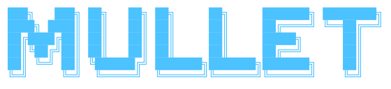

<p align="center">
  
</p>

<p align="center">
  <strong>SkyMule · an open drone stack on PX4 + ROS 2</strong><br>
  Multi-drone autonomy for Jetson, from operator browser to flight controller.
</p>

<p align="center">
  
  
  
  
</p>

---

## 🚁 What we build

**MULLET** is the SkyMule drone stack: a set of small, single-purpose repositories that together
fly PX4 multicopters under ROS 2 Jazzy on NVIDIA Jetson companion computers.

The design rule is a hard control boundary:

- **PX4** owns real-time flight: attitude, motors, failsafes.
- **The onboard supervisor** is a deterministic offboard layer: arming, takeoff, land, hold, command validation.
- **Mission frameworks** plan; they never talk to PX4 directly.
- **Operators** drive everything through semantic actions, not raw setpoints.

```text
Browser UI ─► gateway ─► mullet_interfaces ─► onboard supervisor ─► PX4
                                  ▲                    │
                      mission frameworks ──────────────┘
```

## 🧩 Open repositories

| Repo | What it does |
|---|---|
| [`mullet-interfaces`](https://github.com/skymule-ai/mullet-interfaces) | Shared ROS 2 actions, messages and services, the wire contract every part of the stack builds against |

More of the stack will be opened up over time.

---

<p align="center">
  <sub>Built by SkyMule · issues and pull requests welcome</sub>
</p>
