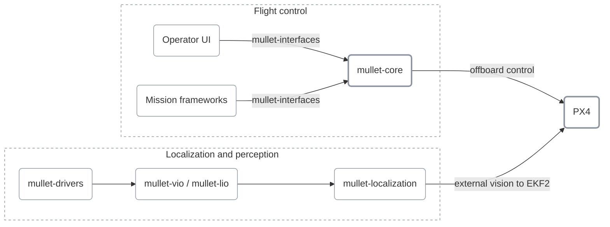

  <picture>
    <source media="(prefers-color-scheme: dark)" srcset="assets/logos/skymule_full_white.png">
    
  </picture>

  <strong>An open autonomy stack for PX4 multicopters on ROS 2</strong> 
  From the operator console to the flight controller, built for NVIDIA Jetson companion computers.

  
  
  
  

---

## Overview

**MULLET** is the SkyMule drone stack: a set of small, single-purpose repositories that together
fly PX4 multicopters under ROS 2 Jazzy on NVIDIA Jetson companion computers. Every component
ships as a versioned container image, so a drone runs a pinned, reproducible set of images.

The architecture is built around a hard control boundary:

- **PX4** owns real-time flight: attitude, motor mixing and failsafes.
- **mullet-core** is a deterministic offboard supervisor: arming, takeoff, landing, hold and command validation.
- **Mission frameworks** plan trajectories and stream setpoints through the supervisor; they never publish to PX4 directly.
- **Operators** command drones through semantic actions, not raw setpoints.
- **Localization** feeds PX4's EKF2 through a single external-vision bridge.

## Repositories

### Flight control

| Repository | Description |
|---|---|
| [mullet-core](https://github.com/skymule-ai/mullet-core) | C++ ROS 2 offboard supervisor for PX4: state machine, takeoff/land/return-home actions, setpoint streaming and guardrails |
| [mullet-interfaces](https://github.com/skymule-ai/mullet-interfaces) | Shared ROS 2 actions, messages and services: the wire contract between operators, missions and the supervisor |

### Localization and perception

| Repository | Description |
|---|---|
| [mullet-localization](https://github.com/skymule-ai/mullet-localization) | Per-drone Compose deployment: pins driver and estimator images, holds sensor calibration, and bridges the estimate into PX4 EKF2 |
| [mullet-drivers](https://github.com/skymule-ai/mullet-drivers) | Sensor driver images for the Intel RealSense D435i and Livox MID-360, plus an optional RViz / Foxglove visualization image |
| [mullet-vio](https://github.com/skymule-ai/mullet-vio) | Visual-inertial odometry images, currently OpenVINS |
| [mullet-lio](https://github.com/skymule-ai/mullet-lio) | LiDAR-inertial odometry images (in development) |

### Documentation

| Repository | Description |
|---|---|
| [mullet-wiki](https://github.com/skymule-ai/mullet-wiki) | Stack documentation: architecture, components and field procedures, served locally with MkDocs |

## Contributing

Issues and pull requests are welcome in any of the repositories above. Start with
[mullet-interfaces](https://github.com/skymule-ai/mullet-interfaces) to see how the components
talk to each other, and [mullet-wiki](https://github.com/skymule-ai/mullet-wiki) for how they fit together.

---

  © SkyMule

